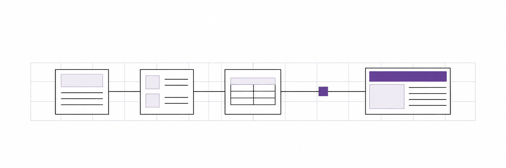

`Интенсив Nord · День 2`

# Подготовьте недельный отчёт для CEO

Учебный пример ООО «Рога и Копыта». Соберите отчёт о запуске AI Workspace Layer за 18–22 мая 2026 года. Генеральному директору нужно за две–три минуты понять, как идёт запуск, где риски и какие решения требуются от него.



## Сделать отчёт

1. Откройте папку репозитория на своём компьютере в Codex. Если папки ещё нет, на GitHub нажмите **Code → Download ZIP** и распакуйте архив. Codex прочитает документы из этой папки и сохранит в ней черновик.
2. Скопируйте запрос и вставьте его в новый чат.

   ```text
   Подготовь черновик недельного отчёта для CEO ООО «Рога и Копыта» за 18–22 мая 2026 года. Используй поручение и файлы, указанные в `06_context_capsules/weekly_launch_update.md`. Сохрани результат в новой папке прогона.
   ```

3. Откройте новый `output.md` в папке [`07_runs/weekly-launch-update/`](07_runs/weekly-launch-update/).

## Сверить с источниками

Откройте ссылку рядом с датой в черновике. Сравните дату и её статус с документом: что утвердили, что предложили и о чём попросили. Затем проверьте риски, пробелы и вопросы к руководителю. [Список для проверки](00_START_HERE.md#как-проверить-отчёт).

Можно свериться с [пробным черновиком](07_runs/weekly-launch-update/2026-11-17-may18-22-draft/output.md) и посмотреть, что в нём стоит уточнить. [Разбор черновика](07_runs/weekly-launch-update/2026-11-17-may18-22-draft/verification.md).

## Найти нужный файл

Контекстный слой — это файлы и правила, которые помогают агенту выполнить задачу. Для отчёта за эту неделю все материалы уже собраны.

- [`06_context_capsules/`](06_context_capsules/) — поручение, список файлов и порядок подготовки отчёта.
- [`02_sources/`](02_sources/) — цель, заметки недели, решения и клиентские сигналы.
- [`03_representations/`](03_representations/) — короткие сводки со ссылками на исходные записи.
- [`04_canonical_context/`](04_canonical_context/) — сведения о компании и правила работы с данными.
- [`05_current_context/`](05_current_context/) — состояние запуска на конец недели и открытые вопросы.
- [`01_cards/`](01_cards/) — как собрали материалы и что проверили в ответах.
- [`07_runs/`](07_runs/) — сохранённые черновики, их источники и разборы.

В архивных снимках используется исходное название компании. [Исходная версия учебного примера](https://github.com/densmirnov/acme-labs/tree/a87a7fe547b1f8d61c6c00dbb186427dceda5a4d/context-layer).
